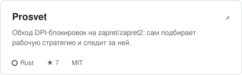
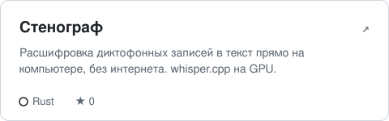
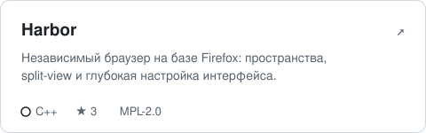
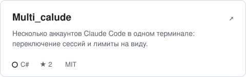
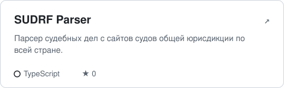
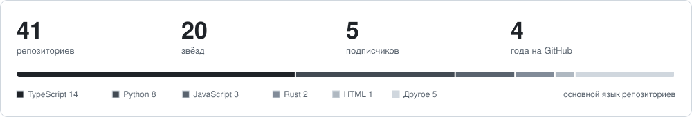

<a href="https://github.com/Ivantech123">
  <picture>
    <source media="(prefers-color-scheme: dark)" srcset="assets/header-dark.svg">
    
  </picture>
</a>

<p>
  <a href="https://t.me/IDEVOP"></a>
  <a href="mailto:abloko362@gmail.com"></a>
  
</p>

Делаю приложения, которые работают у человека на компьютере, а не в чужом облаке: обход блокировок, расшифровка речи офлайн, браузер, p2p-сеть. Много пишу для юристов — парсеры судов, OCR, генераторы документов.

```rust
let me = Dev {
    stack:  ["Rust", "TypeScript", "Python", "C#", "C++"],
    apps:   ["Tauri 2", "React", "Next.js", "Android"],
    ai:     ["whisper.cpp", "LLM-агенты", "RAG"],
    now:    "Prosvet, Стенограф, Harbor",
};
```

<p>
  
</p>

### Проекты

<table>
<tr>
<td width="50%"><a href="https://github.com/Ivantech123/Prosvet_antizapret_app"><picture><source media="(prefers-color-scheme: dark)" srcset="assets/repo-prosvet-antizapret-app-dark.svg"></picture></a></td>
<td width="50%"><a href="https://github.com/Ivantech123/Stenograv_app"><picture><source media="(prefers-color-scheme: dark)" srcset="assets/repo-stenograv-app-dark.svg"></picture></a></td>
</tr>
<tr>
<td width="50%"><a href="https://github.com/Ivantech123/Harbor"><picture><source media="(prefers-color-scheme: dark)" srcset="assets/repo-harbor-dark.svg"></picture></a></td>
<td width="50%"><a href="https://github.com/Ivantech123/Multi_calude"><picture><source media="(prefers-color-scheme: dark)" srcset="assets/repo-multi-calude-dark.svg"></picture></a></td>
</tr>
<tr>
<td width="50%"><a href="https://github.com/Ivantech123/ULN"><picture><source media="(prefers-color-scheme: dark)" srcset="assets/repo-uln-dark.svg"></picture></a></td>
<td width="50%"><a href="https://github.com/Ivantech123/SUDRF-PARSER-"><picture><source media="(prefers-color-scheme: dark)" srcset="assets/repo-sudrf-parser-dark.svg"></picture></a></td>
</tr>
</table>

<details>
<summary><b>Ещё проекты</b> — инструменты для юристов, боты, веб</summary>
<br>

**Для юристов**
- [Lextools](https://github.com/Ivantech123/Lextools-) — универсальное приложение для юристов
- [LEXOCR](https://github.com/Ivantech123/LEXOCR) — OCR для юридических документов
- [legal-docs-gpt-generator](https://github.com/Ivantech123/legal-docs-gpt-generator) — генератор юридических документов на GPT
- [russian-duties-calculator](https://github.com/Ivantech123/russian-duties-calculator) — калькулятор госпошлин
- [legalmath](https://github.com/Ivantech123/legalmath) — площадка, которая сводит клиентов и юристов

**AI и боты**
- [Speech-to-text-tool](https://github.com/Ivantech123/Speech-to-text-tool) — Flask API для распознавания речи
- [cloneself](https://github.com/Ivantech123/cloneself) — чат-бот с голосом и личностью
- [claudetuine](https://github.com/Ivantech123/claudetuine) — дообучение и RAG поверх Claude
- [aistatbot](https://github.com/Ivantech123/aistatbot) · [aireadybot](https://github.com/Ivantech123/aireadybot) — Telegram-боты

**Веб**
- [BYTEZONE](https://bytezone-sandy.vercel.app) · [Tourgame](https://tourgame-eight.vercel.app) · [Jornual](https://jornual.vercel.app) · [CP Harant](https://cp-harant.vercel.app)

</details>

### Статистика

<picture>
  <source media="(prefers-color-scheme: dark)" srcset="assets/stats-dark.svg">
  
</picture>

<picture>
  <source media="(prefers-color-scheme: dark)" srcset="https://raw.githubusercontent.com/Ivantech123/Ivantech123/output/snake-dark.svg">
  
</picture>

<details open>
<summary><b>Что происходит сейчас</b></summary>
<br>

<!--ACTIVITY:START-->
- ⬆ [Stenograv_app](https://github.com/Ivantech123/Stenograv_app) <sub>· 8 дн. назад</sub>
- ⬆ [Prosvet_antizapret_app](https://github.com/Ivantech123/Prosvet_antizapret_app) <sub>· 9 дн. назад</sub>
- 📦 [Stenograv_app](https://github.com/Ivantech123/Stenograv_app) — релиз v2.0.0 <sub>· 8 дн. назад</sub>
- 📦 [Prosvet_antizapret_app](https://github.com/Ivantech123/Prosvet_antizapret_app) — релиз v0.3.0 <sub>· 8 дн. назад</sub>
- 📦 [Prosvet_antizapret_app](https://github.com/Ivantech123/Prosvet_antizapret_app) — релиз v0.2.0 <sub>· 9 дн. назад</sub>
- 📦 [Prosvet_antizapret_app](https://github.com/Ivantech123/Prosvet_antizapret_app) — релиз v0.1.0 <sub>· 9 дн. назад</sub>
<!--ACTIVITY:END-->

<sub>Обновляется автоматически раз в сутки.</sub>
</details>
