<a href="https://github.com/Ivantech123">
  <picture>
    <source media="(prefers-color-scheme: dark)" srcset="assets/header-dark.svg">
    
  </picture>
</a>

<p>
  <a href="https://t.me/IDEVOP"></a>
  <a href="mailto:abloko362@gmail.com"></a>
  
</p>

Делаю приложения, которые работают у человека на компьютере, а не в чужом облаке: обход блокировок, расшифровка речи офлайн, браузер, p2p-сеть. Много пишу для юристов — парсеры судов, OCR, генераторы документов.

```rust
let me = Dev {
    stack:  ["Rust", "TypeScript", "Python", "C#", "C++"],
    apps:   ["Tauri 2", "React", "Next.js", "Android"],
    ai:     ["whisper.cpp", "LLM-агенты", "RAG"],
    now:    "Prosvet, Стенограф, Harbor",
};
```

<p>
  
</p>

### Проекты

<table>
<tr>
<td width="50%"><a href="https://github.com/Ivantech123/Prosvet_antizapret_app"><picture><source media="(prefers-color-scheme: dark)" srcset="assets/repo-prosvet-antizapret-app-dark.svg"></picture></a></td>
<td width="50%"><a href="https://github.com/Ivantech123/Stenograv_app"><picture><source media="(prefers-color-scheme: dark)" srcset="assets/repo-stenograv-app-dark.svg"></picture></a></td>
</tr>
<tr>
<td width="50%"><a href="https://github.com/Ivantech123/Harbor"><picture><source media="(prefers-color-scheme: dark)" srcset="assets/repo-harbor-dark.svg"></picture></a></td>
<td width="50%"><a href="https://github.com/Ivantech123/Multi_calude"><picture><source media="(prefers-color-scheme: dark)" srcset="assets/repo-multi-calude-dark.svg"></picture></a></td>
</tr>
<tr>
<td width="50%"><a href="https://github.com/Ivantech123/ULN"><picture><source media="(prefers-color-scheme: dark)" srcset="assets/repo-uln-dark.svg"></picture></a></td>
<td width="50%"><a href="https://github.com/Ivantech123/SUDRF-PARSER-"><picture><source media="(prefers-color-scheme: dark)" srcset="assets/repo-sudrf-parser-dark.svg"></picture></a></td>
</tr>
</table>

#### Подробнее о каждом

<details>
<summary><b>Prosvet</b> — обход блокировок одной кнопкой · Rust · Tauri 2</summary>
<br>

Оболочка над движками обхода DPI [zapret2 / zapret](https://github.com/bol-van/zapret2) и стратегиями Flowseal. Вместо двадцати `.bat`-файлов — одна кнопка: YouTube, Discord и другие сервисы снова работают, без VPN, серверов и подписок.

- **Сам подбирает стратегию** — проверяет, что заблокировано у провайдера, перебирает ~30 стратегий и оставляет лучшую.
- **Сторож** — периодически проверяет доступ и переключается, если провайдер что-то поменял; раз в сутки перепроверяет всё заново.
- **Честная проверка** — тестер докачивает данные и ловит характерную для ТСПУ «заморозку» соединения на ~16 КБ.
- **Умный DNS для ИИ** — Gemini, ChatGPT, Claude и другие, которые сами блокируют Россию, идут через прозрачный прокси; остальной трафик остаётся локальным.
- Живёт в трее, стартует без UAC, движок завершается вместе с приложением (Job Object), находит конфликтующие GoodbyeDPI/zapret.

[Скачать](https://github.com/Ivantech123/Prosvet_antizapret_app/releases/latest) · [Исходники](https://github.com/Ivantech123/Prosvet_antizapret_app)
</details>

<details>
<summary><b>Стенограф</b> — расшифровка записей без интернета · Rust · whisper.cpp</summary>
<br>

Запись заседания или консультации нельзя отдавать в облако — Стенограф распознаёт речь прямо на компьютере. WMA, MP3, M4A, AMR, видео → TXT, DOCX, SRT.

- **Сам подбирает режим под железо**: на RTX 4060 — до ×64 быстрее реального времени, на процессоре — около ×2. Видеокарты через Vulkan: GeForce, Radeon, Intel Arc.
- **Словарь** имён и номеров дел: «А40 Дефис 12345» превращается в «А40-12345/2026».
- **Чистка мусора Whisper** — фантомные «Субтитры сделал…» на тишине и зацикленные повторы.
- **DOCX по делопроизводству**: Times New Roman 12, отступы, поля; абзацы по паузам с метками времени.
- Очередь файлов, не затирает ваши правки, установка без прав администратора, 11 МБ.

[Скачать](https://github.com/Ivantech123/Stenograv_app/releases/latest) · [Исходники](https://github.com/Ivantech123/Stenograv_app)
</details>

<details>
<summary><b>Harbor</b> — свой браузер на Firefox · C++ · JS</summary>
<br>

Независимый браузер на базе Firefox 156: вертикальные вкладки, пространства, split-view, магазин модов и подробная настройка внешнего вида. Каналы Release и Twilight.

[Скачать](https://github.com/Ivantech123/Harbor/releases/latest) · [Исходники](https://github.com/Ivantech123/Harbor)
</details>

<details>
<summary><b>Multi_calude</b> — несколько аккаунтов Claude Code · C#</summary>
<br>

- До пяти аккаунтов: у каждого свой вход, а история, память, скиллы и плагины общие.
- Кончился лимит — `/switch-account`, и та же сессия продолжается под другим аккаунтом.
- 5-часовой и недельный лимиты всех аккаунтов в меню, строке состояния и в трее.
- Поиск по сессиям, корзина, избранные проекты, анимированный маскот и три темы.
- Windows, macOS и Linux, x64 и ARM.

[Скачать](https://github.com/Ivantech123/Multi_calude/releases/latest) · [Исходники](https://github.com/Ivantech123/Multi_calude)
</details>

<details>
<summary><b>ULN</b> — сеть юристов без серверов · JavaScript</summary>
<br>

United Lawyer Network — русская сборка p2p-сети [Ember](https://github.com/CRTnoise/ember-p2p) для юристов: посты, обсуждения и зашифрованная переписка идут напрямую между участниками, без аккаунтов и компании посередине. Протокол совместим с Ember.

[Сайт](https://social.a2chatsky.ru) · [Скачать](https://github.com/Ivantech123/ULN/releases/latest) · [Исходники](https://github.com/Ivantech123/ULN)
</details>

<details>
<summary><b>SUDRF Parser</b> — MCP-сервер для ГАС «Правосудие» · TypeScript</summary>
<br>

ГАС «Правосудие» — это не один API, а тысячи сайтов судов со своей вёрсткой и кодировкой Windows-1251. Парсер делает программно то, что человек делает в браузере.

- Расписание заседаний без капчи, расширенный поиск по номеру, УИД, участнику, ИНН, судье и датам.
- Карточка дела: участники, движение, тексты актов.
- Реестр ~2269 судов РФ с поиском по региону и поддомену.
- Работает как MCP-сервер — подключается к ИИ-ассистентам.

[Исходники](https://github.com/Ivantech123/SUDRF-PARSER-)
</details>

<details>
<summary><b>Ещё проекты</b> — инструменты для юристов, боты, веб</summary>
<br>

**Для юристов**
- [Lextools](https://github.com/Ivantech123/Lextools-) — универсальное приложение для юристов
- [LEXOCR](https://github.com/Ivantech123/LEXOCR) — OCR для юридических документов
- [legal-docs-gpt-generator](https://github.com/Ivantech123/legal-docs-gpt-generator) — генератор юридических документов на GPT
- [russian-duties-calculator](https://github.com/Ivantech123/russian-duties-calculator) — калькулятор госпошлин
- [legalmath](https://github.com/Ivantech123/legalmath) — площадка, которая сводит клиентов и юристов

**AI и боты**
- [Speech-to-text-tool](https://github.com/Ivantech123/Speech-to-text-tool) — Flask API для распознавания речи
- [cloneself](https://github.com/Ivantech123/cloneself) — чат-бот с голосом и личностью
- [claudetuine](https://github.com/Ivantech123/claudetuine) — дообучение и RAG поверх Claude
- [aistatbot](https://github.com/Ivantech123/aistatbot) · [aireadybot](https://github.com/Ivantech123/aireadybot) — Telegram-боты

**Веб**
- [BYTEZONE](https://bytezone-sandy.vercel.app) · [Tourgame](https://tourgame-eight.vercel.app) · [Jornual](https://jornual.vercel.app) · [CP Harant](https://cp-harant.vercel.app)

</details>

### Как я работаю

- **Локально по умолчанию.** Если задачу можно решить на компьютере пользователя — решаю там: без серверов, аккаунтов и утечек данных.
- **Одна кнопка вместо инструкции.** Сложное (DPI, нейросети, парсинг судов) прячу за понятным интерфейсом.
- **Релизы, а не прототипы.** Установщики, автообновление, тёмная и светлая тема, русский язык из коробки.

### Статистика

<picture>
  <source media="(prefers-color-scheme: dark)" srcset="assets/stats-dark.svg">
  
</picture>

<picture>
  <source media="(prefers-color-scheme: dark)" srcset="assets/contrib-dark.svg">
  
</picture>

<picture>
  <source media="(prefers-color-scheme: dark)" srcset="assets/snake-dark.svg">
  
</picture>

<details open>
<summary><b>Что происходит сейчас</b></summary>
<br>

<!--ACTIVITY:START-->
- ⬆ [Stenograv_app](https://github.com/Ivantech123/Stenograv_app) <sub>· 8 дн. назад</sub>
- ⬆ [Prosvet_antizapret_app](https://github.com/Ivantech123/Prosvet_antizapret_app) <sub>· 9 дн. назад</sub>
- 📦 [Stenograv_app](https://github.com/Ivantech123/Stenograv_app) — релиз v2.0.0 <sub>· 8 дн. назад</sub>
- 📦 [Prosvet_antizapret_app](https://github.com/Ivantech123/Prosvet_antizapret_app) — релиз v0.3.0 <sub>· 8 дн. назад</sub>
- 📦 [Prosvet_antizapret_app](https://github.com/Ivantech123/Prosvet_antizapret_app) — релиз v0.2.0 <sub>· 9 дн. назад</sub>
- 📦 [Prosvet_antizapret_app](https://github.com/Ivantech123/Prosvet_antizapret_app) — релиз v0.1.0 <sub>· 9 дн. назад</sub>
<!--ACTIVITY:END-->

<sub>Статистика, змейка и лента собираются скриптом <code>scripts/build.mjs</code>.</sub>
</details>
